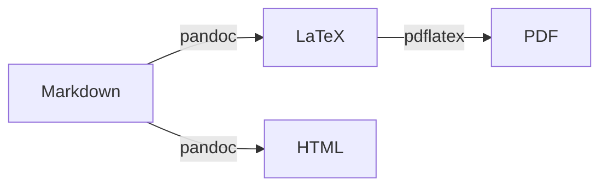
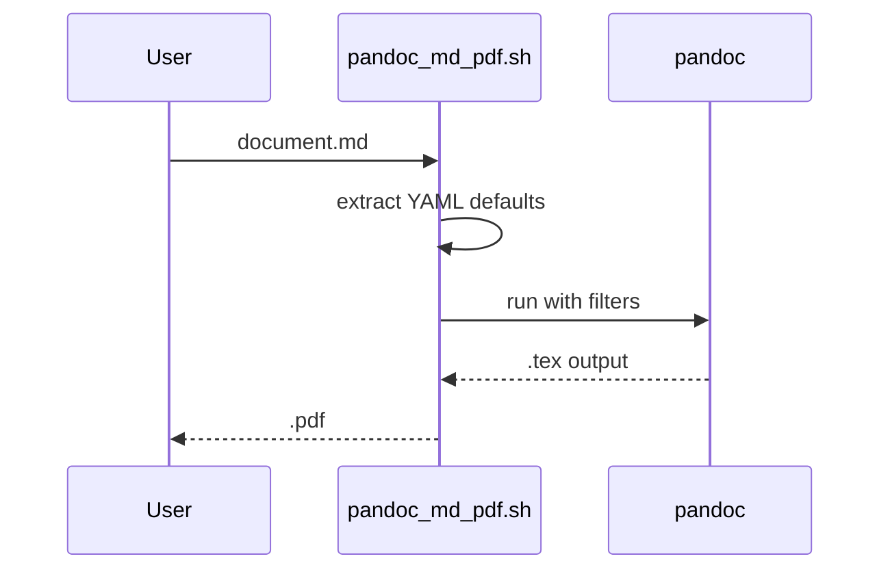
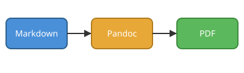

# CSV Tables

```{.csvtable caption="Benchmark Results"}
n,time_ms,error
10,0.0,9.47e-17
100,0.44,5.90e-16
1000,3.75,1.48e-15
10000,39.9,8.27e-16
```

# Mermaid Diagrams





# SVG Images

<!-- svg_to_pdf.py converts SVG to PDF when targeting LaTeX; passes through for HTML -->



# Include Files

<!-- include-files.lua: include external markdown at compile time -->

```{.include shift-heading-level-by=1}
// comments are supported
README.md
```

# Include Code Files

<!-- include-code-files.lua: embed source code from external files -->

Full file:

```{.python include="filters/csv_tex_table.py"}
```

Line range with dedent:

```{.lua include="filters/columns.lua" startLine=1 endLine=10}
```

# Multi-Column Layout

::: {.columns column-count=3 column-gap="1.5em"}
**Column 1** — Filters process the document AST, transforming custom code blocks
and divs into native pandoc elements.

::: columnbreak
:::

**Column 2** — Output adapts to the target format: LaTeX uses `multicols`,
HTML uses CSS columns.

::: columnbreak
:::

**Column 3** — All filters can be combined freely in a single document
via the YAML front matter.
:::

## Shorthand syntax

::: two-columns
Left column content goes here. The `two-columns` class is syntactic sugar
for `{.columns column-count=2}`.

::: columnbreak
:::

Right column content goes here.
:::

## Column span

::: {.columns column-count=2}
Left column.

::: columnbreak
:::

Right column.
:::

::: column-span
This paragraph spans across all columns.
:::

# YAML Tables

## Vertical table with auto-numbering

```{.table #tbl:team}
caption: Team Roles
series:
  - title: "#"
    special: number
    align: right
  - title: Role
    id: role
  - title: Responsibility
    id: resp
data:
  - role: Developer
    resp: |
      * Write **quality** code
      * Review pull requests
  - role: Designer
    resp: |
      * Create mockups
      * Maintain style guide
  - role: Manager
    resp: |
      * Coordinate team
      * Report status
```

## Horizontal table

```{.table .horizontal #tbl:measurements}
caption: Sensor Readings
series:
  - title: "Current (mA)"
    id: i
  - title: "Voltage (V)"
    id: v
  - title: "Power (mW)"
    id: p
data:
  - i: 15
    v: 3.0
    p: 45
  - i: 16
    v: 3.1
    p: 49.6
  - i: 14
    v: 2.9
    p: 40.6
```

## Table from template

<!-- Template "card" is defined in the YAML front matter metadata -->

```{.table #tbl:project}
template: card
caption: Project Info
data:
  - field: Name
    value: pandoc-utils
  - field: Language
    value: Python, Lua, Bash
  - field: License
    value: MIT
```
