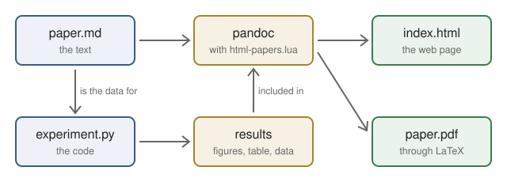
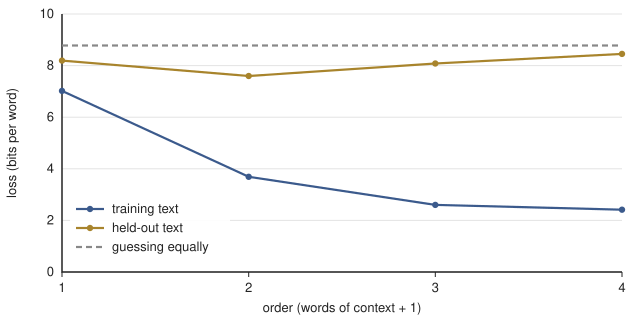
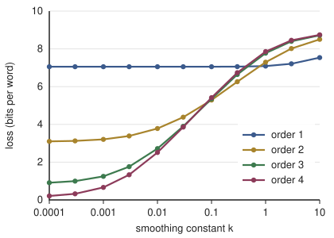
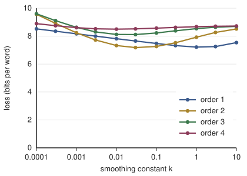
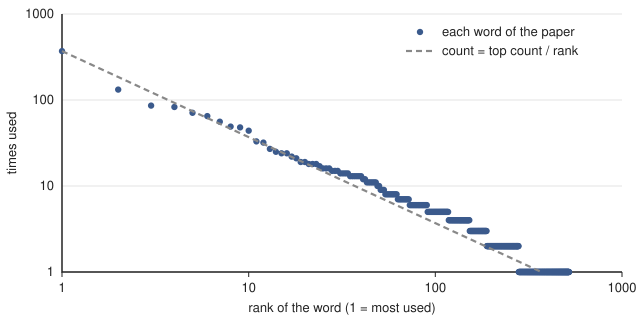

# Introduction {#sec:intro}

A paper has two parts that are kept in different places. One is the text. The other is the scripts and notebooks that produced the numbers and figures in the text. The two drift apart: a figure is redrawn and the sentence about it is not, or the code that made a table can no longer be found. For programs, Knuth proposed writing the explanation and the code as one document, in the order that suits the reader [@knuth1984literate]. This paper does the same for a paper, and it is its own example.

The file you are reading was built from one markdown file. The build ran an experiment, and the results of that experiment are the ones reported here. The experiment is small on purpose. We fit \term[n-gram models]{ngram} to the text of this paper and measure how well they predict the sentences they were not shown.[^footnote] Nothing in it is new [@shannon1948mathematical; @shannon1951prediction]. It is here because it needs everything a paper needs: definitions, equations, a table, figures, code and references.

The paper makes three points, each by doing it:

- **One source, two outputs.** The same file builds a web page and a PDF, with the same numbers on the sections, figures and references (\autoref{sec:build}).
- **The page helps the reader.** On the web page a reference shows what it refers to, a term shows its definition, a figure can become live, and a reader can leave comments (\autoref{sec:writing} and \autoref{sec:review}).
- **The results come from the build.** The numbers in \autoref{tab:loss}, the figures of \autoref{sec:results} and the code in \autoref{fig:model} are made or included by the build, so they cannot disagree with the code that ran (\autoref{sec:experiment}).

[^footnote]: A footnote. On the web page it opens beside the text while the pointer is on its number, and stays if you click it. In the PDF it is at the foot of the page.

# One source, two outputs {#sec:build}

The source is `paper.md`, written in the markdown that pandoc reads [@macfarlane2006pandoc]. \autoref{fig:pipeline}, the one figure here that is drawn by hand, shows the build. First the experiment runs. It reads the text of the paper and writes the charts, the table and the numbers behind the live figures. Then pandoc reads `paper.md` twice, once to write the web page and once to write LaTeX, which becomes the PDF. Both times pandoc runs \term{filter}, which turns each construct of the paper into what that output needs. A cross-reference becomes a numbered link on the page and stays a reference in LaTeX. A term becomes a link that carries its definition on the page and a tooltip in the PDF.

{#fig:pipeline}

The script that does this is short enough to print. \autoref{fig:build} is not a copy of it. The build includes the file, so the script you read is the script that ran.

::: {#fig:build .figure}
```{.bash include="build.sh"}
```

The file `build.sh`, included from the folder it built. A captioned block of anything is a numbered figure.
:::

The settings are in the front matter of `paper.md`: the bibliography, the filters to run and the file of terms. Besides its figures and the pages behind its live figures, the finished page needs five scripts and two stylesheets, and nothing else. It needs no server, and it loads nothing from the network. Its equations are MathML, which a browser draws on its own.

# Writing {#sec:writing}

Most of the source is plain markdown and reads like the text. This section shows the constructs that are not plain markdown, each beside its source.

## Cross-references {#sec:refs}

A heading, a figure or a table is given an id, and `\autoref` refers to it:

```markdown
## Cross-references {#sec:refs}

See \autoref{sec:model}, \autoref{fig:loss} and \autoref{tab:loss}.
```

This gives: see \autoref{sec:model}, \autoref{fig:loss} and \autoref{tab:loss}. The reference becomes the number of its target in both outputs, also when the target comes later in the text. On the web page, hovering the link shows a copy of the target in the margin, so a reader who wants to check a figure does not lose their place. A figure in a copy is made smaller until it fits, so a copy of a figure never has to be scrolled. A link inside a copy opens another copy below it. Clicking a copy keeps it open. A reference to an id that does not exist still builds. On the web page it shows in red, and the build warns. In the PDF it is the pair of question marks that LaTeX prints.

## Terms {#sec:terms}

A paper names things, and a reader who skipped the definition is lost. Here a term is defined once, in a file of terms that begins:

```{.yaml include="terms.yaml" endLine=5}
```

Writing `\term{loss}` in the text then gives \term{loss}. The word is a link to the section that defines it, and the definition shows in the margin when the pointer is on the word. In the PDF it is a tooltip. Writing `\term[losses]{loss}` shows other words for the same term. A name that is not in the file stops the build and says which name it was.

## Citations, notes and equations {#sec:cites}

Citations are the ones pandoc has. Writing `[@knuth1984literate]` gives [@knuth1984literate], and two keys in one bracket give [@mikolov2013efficient; @vaswani2017attention]. On the web page a citation shows its references in the margin. In the list of references a title that has a web address is a link, and so is an arXiv number. Footnotes show in the margin in the same way.[^second] Equations are written as in LaTeX, as in \autoref{sec:loss}. A note from the author to the author is hard to miss in both outputs: \TODO{take this out before the paper is sent}

[^second]: A second footnote, so that there are two to compare.

# The experiment {#sec:experiment}

## Data {#sec:data}

The data is this paper. The experiment reads `paper.md` and keeps the prose as words in lower case, with a mark at the end of each sentence. It drops the code, the equations and the citations. A caption keeps its words, and a term counts as the words it shows. Every fifth sentence is set aside as the \term{heldout}. The other sentences are the \term{training}. The models count only the training text. Because the text is the data, changing a sentence of this paper changes its results, and the next build reports the new ones.

## Model {#sec:model}

An \term{ngram} of \term{order} $n$ predicts a word from the $n - 1$ words before it. It counts how often each word followed those words in the training text [@shannon1948mathematical]. A word that never followed them would get a probability of zero, and then one new sentence would be impossible. So the model counts every word $k$ more times than it was seen, which is called \term{smoothing} [@chen1999empirical]:

$$
P(w \mid c) = \frac{\operatorname{count}(c, w) + k}{\operatorname{count}(c) + k V}
$$

Here $c$ is the context, the $n - 1$ words before the word $w$, and $V$ is the number of different words. \autoref{fig:model} is the whole model. It is the file that the experiment imports.

::: {#fig:model .figure}
```{.python include="model.py"}
```

The file `model.py`: the model, its \term{loss} and how it continues a text.
:::

## Loss {#sec:loss}

A model is scored on a text $w_1, \dots, w_N$ by its \term{loss}, the cross-entropy in bits per word [@shannon1951prediction]:

$$
L = -\frac{1}{N} \sum_{i=1}^{N} \log_2 P(w_i \mid c_i)
$$

A model that gave each of the $V$ words the same probability would have a loss of $\log_2 V$ on any text. A model has learned something when its loss on the held-out text is below that.

# Results {#sec:results}

The build writes everything in this section except the prose. The prose makes claims about the numbers, and the experiment checks each claim before it writes anything (\autoref{sec:code}). If a change to the text makes a claim false, the build stops.

## Loss by order {#sec:loss-by-order}

\autoref{tab:loss} gives the \term{loss} of each model, at one \term{smoothing} constant. There, on the \term{training}, a higher \term{order} is always better. On the \term{heldout} it is not. One word of context helps, so the model of order 2 is the best. Each word of context after that makes the model worse, and the model of order 4 is hardly better than guessing every word equally. The last column of the table says why. The longer the context, the less often the model has seen it, and a model that has not seen the context knows nothing about the next word.

```{.include}
generated/results.md
```

The markdown of the table has two things that a plain table does not. A row whose first cell is bold joins the header, which is where the word counts are. A footnote in a cell shows as an asterisk on the web page, and its note shows in the margin while the pointer is anywhere in the cell.

\autoref{fig:loss} draws the same numbers. On the web page the figure is a picture until it is clicked. Then it is a small live page with a slider for the \term{smoothing} constant, and nothing is loaded before the click. Moving the slider shows that the best order on the held-out text is not the same at every constant.

{#fig:loss interactive-src="live/curve.html" interactive-embed="live/curve.html#embed" interactive-height="330"}

## Smoothing {#sec:smoothing}

How much \term{smoothing} is best depends on which text is asked about (\autoref{fig:smoothing}). On the training text less is always better (\autoref{fig:smoothing-train}), because every count given to a word that did not come is taken from a word that did. With almost none, the model of order 4 has a loss close to zero there: it has memorised the paper. On the held-out text the least smoothing is never the best (\autoref{fig:smoothing-heldout}). From order 2 up, the constant matters less as the order goes up, because in a context the model has not seen, every word gets the same probability whatever the constant is.

::: {#fig:smoothing .subfigures}
{#fig:smoothing-train}

{#fig:smoothing-heldout}

Loss against the smoothing constant $k$, with one line for each order. Two images in one figure, each with its own number.
:::

## What the models write {#sec:write}

A model can also write. Give it some words, take the word it finds most likely, and repeat. \autoref{fig:continue} starts every model with the same three words, the run of three words that is most common in the training text. The first row is how the paper goes on from there. The model of order 1 does not look at the prompt, and repeats the most common word. The models of higher order can only say what they have counted, so what they write is made of pieces of the paper.

::: {#fig:continue .generations src="generated/continuations.json"}
Each model continues the same prompt, one word on each chip. The rows are read from a file that the experiment writes.
:::

## The words {#sec:words}

\autoref{fig:words} counts how often each word of the paper is used. As in most text, a few words are used very often and most words only once or twice [@zipf1949human]. Here the ten most used words are more than a fifth of the text. The page that lists every word with its count is too long to put inside a figure. So this figure stays a picture, with a link to that page under it.

{#fig:words interactive-link="live/words.html"}

# Reviewing {#sec:review}

A draft gets comments. On the web page, pressing **E** turns on review mode. The reader selects some text and comments on it. The reader can also switch to suggesting, and then type into the text, which marks the change and leaves the text as it was. Nothing is sent anywhere. The comments stay in the browser of the reader until the reader exports them as a file and sends the file to the author.

The author puts the files in a folder and runs one command:

```sh
uv run html-papers/collect_reviews.py reviews/ --md paper.md -o reviews/merged.json
```

The command merges the files and keeps the newest version of each comment. It lists every comment with the line of `paper.md` that the comment is about, which it finds from the words the reader selected. So a comment made on the page leads to the line to change. The merged file can be loaded back into the page, to read all the comments in place.

# Limits {#sec:limits}

- The numbers in the table and the figures come from the build. The numbers in a sentence do not. That is why the prose of \autoref{sec:results} quotes no numbers, and why the experiment checks its claims.
- The scripts and stylesheets beside the page are copies. Nothing updates the copies when the originals change.
- The notes are made for a pointer or a finger. From the keyboard, Enter opens the note of a citation or a footnote. On a term or a reference it only follows the link.
- The experiment is a toy. One paper is far too little text to learn much about a language, and models of language stopped counting words long ago [@bengio2003neural; @mikolov2013efficient; @vaswani2017attention].

# Appendix {#sec:appendix}

## The code of the experiment {#sec:code}

This is `experiment.py`, included from the file. It imports the model of \autoref{fig:model} and a small module that draws the charts, `svgplot.py`, which is beside the page and is not printed here. The claims that the prose of \autoref{sec:results} makes are the lines that begin with `assert`.

```{.python include="experiment.py"}
```

## What to try {#sec:try}

On the web page:

- Hover a reference to a section, figure or table. A copy of it opens in the margin. Hover a link inside the copy for another copy below it.
- Click a note to keep it open. The cross in its corner closes it.
- Hover a term such as \term{loss}, or a citation [@knuth1984literate].
- Hover a cell of \autoref{tab:loss} that has an asterisk.
- Drag the line between the text and the margin, or the edge of the contents, to make a column wider. A double click puts it back.
- **Unpin** folds the contents into a tab at the left edge. They slide out when the pointer goes there.
- Click \autoref{fig:loss} to make it live.
- Press **E**, select some text, and comment on it or suggest a change. The comments share the margin with the notes.
- Make the window narrow, or read on a phone. A tap on a link opens its note in the text, under the paragraph. A swipe to the right opens the contents.

## Starting your own {#sec:start}

Copy this folder. Keep `build.sh`, the front matter of `paper.md`, and the scripts and stylesheets. Replace the text, the terms, the references and the experiment with your own. The build script looks for html-papers two folders up, or where `PANDOC_UTILS` says. The repository of html-papers describes each file and each construct.
